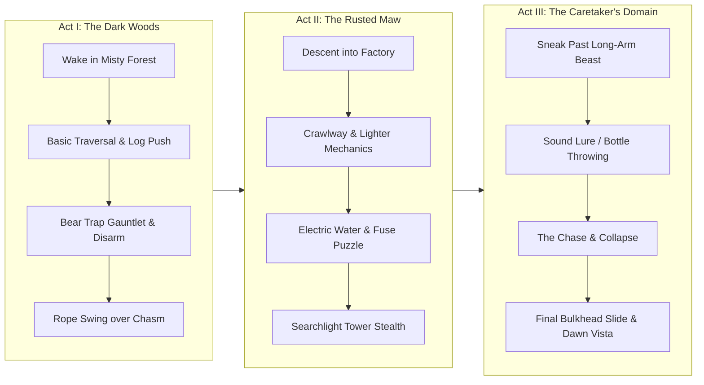

# UMBRA: The Hollow Maw
### Cinematic Puzzle-Platformer Design & Implementation Plan
*Inspired by Limbo and Little Nightmares*

---

## 1. Executive Summary & Vision

**UMBRA: The Hollow Maw** is a dark, atmospheric 2.5D cinematic puzzle-platformer blending the minimalist, high-contrast silhouette horror of *Limbo* with the claustrophobic dread, physical stealth, and grotesque creature evasion of *Little Nightmares*.

The player controls **Nox**, a frail child in an oversized hooded shroud with glowing white eyes, navigating a desolate industrial forest and a sunken, rusted labyrinth known as **The Maw**. Survival depends not on combat, but on physics manipulation, timing, environmental stealth, and outsmarting horrific oversized predators.

---

## 2. Core Pillars & Mechanics

### 2.1 Atmospheric Art Direction (Chiaroscuro & Silhouettes)
- **High-Contrast Silhouette Aesthetic**: Stark black silhouettes for interactables, foreground silhouettes for framing depth, and multiple grayscale parallax layers (fog, twisted trees, rusted gantry cranes, hanging chains).
- **Dynamic Lighting & Shadow Raycasting**:
  - Nox carries a flicking zippo lighter / lantern that casts 2D radial light with dynamic occlusion and soft shadow penumbra.
  - Swaying industrial halogen lamps, sweep searchlights, and environmental fires.
  - Glowing focal points: eyes of creatures, lit switches, bioluminescent fungi.
- **Cinematic Shaders & Post-Processing**:
  - Organic film grain (procedural animated noise).
  - Vignette and chromatic aberration around screen edges.
  - Volumetric misty dust motes / rain / embers reacting to wind.

### 2.2 Fluid Kinematic Character Controller ("Game Feel")
Built according to the `platformer` and `game-feel` skill guidelines:
- **Responsive Physics**:
  - Horizontal acceleration/friction tuned for deliberate weight (not slippery, not instantaneous).
  - Asymmetric gravity (1.8× heavier fall gravity than rise gravity to eliminate floatiness).
  - Coyote time (0.10s) and jump buffering (0.12s) for fair platforming.
  - Variable jump height (releasing jump cuts upward velocity ×0.45).
  - Apex hang (temporary gravity reduction at jump apex for micro-adjustment).
- **Physical Traversal Actions**:
  - **Run & Jump**: Vaulting over pits and traps.
  - **Crouch & Crawl**: Slipping under low beams, crawling inside tight metallic ducts.
  - **Grab & Push/Pull**: Dragging heavy wooden crates, metal carts, and weighted levers.
  - **Ledge Grab & Pull-Up**: Grabbing ledges when jumping short.
  - **Climb & Swing**: Climbing hanging ropes, chains, and rusted ladders; swinging to build momentum.
  - **Lighter/Torch**: Flicking lighter on/off (lights dark areas, but attracts creatures in the dark).

### 2.3 Physical Puzzles & Environmental Traps (Limbo DNA)
- **Bear Traps & Snapping Jaws**: Concealed traps that instantly snap shut; can be triggered safely by dragging a wooden crate or log into them.
- **Counterweight & Pulley Systems**: Pushing boxes onto pressure plates or hanging from counterweight ropes to lift heavy blast gates.
- **Swinging Pendulums & Crushing Pistons**: Timed avoidance hazards.
- **Water & Electrification**: Puddles wired to broken breaker boxes; cutting circuit fuses or moving wooden floating pallets to cross safely.
- **Falling Geometry & Fragile Floorboards**: Creaking floorboards that collapse under weight, requiring sprint-jumps or alternate routing.

### 2.4 Stealth, Sound & Monster AI (Little Nightmares DNA)
Built according to the `game-ai` skill guidelines:
- **"The Caretaker / Long-Arm Lurker"**:
  - A blind, horrifying creature with exceptionally long limbs that hunts by sound and touch.
  - **Hearing Detection**: Running produces noise rings that travel across the environment; tiptoeing/crouching is silent.
  - **Distraction Mechanic**: Picking up and throwing empty bottles, tin cans, or gears to create sound lures and divert the monster's path.
  - **Hiding & Occlusion**: Nox can hide under tables, inside lockers, or behind crates. If inside a shadow/hiding spot and silent, the monster searches past.
- **Searchlights & Security Towers**:
  - Sweeping conical beams of light. Stepping into the beam triggers screeching alarms, machine-gun fire, or security clamps, requiring dash-sliding into shadows.
- **High-Octane Chase Sequences**:
  - Breaker sequence where the monster crashes through a wall; the player must execute a flawless escape through collapsing obstacles and slide under closing bulkhead doors.

### 2.5 Procedural Atmospheric Audio Engine (`audio-design` Skill)
100% synthetically generated audio using the Web Audio API (no external downloads needed):
- **Ambient Soundscapes**:
  - Low-frequency rumble (sub-bass 40Hz-80Hz drone).
  - Howling industrial wind, dripping water, creaking metal cables.
- **Foley & Gameplay Feedback**:
  - Adaptive footstep synthesizer: muffled thuds on soil, creaking on wooden planks, metallic clatter on steel grates, splashing in shallow water.
  - Dynamic heartbeat generator: pulses faster as danger approaches or when hiding with a monster nearby.
  - Heavy mechanical clangs for iron levers, snapping bear trap impacts, and explosive electrical arcs.
  - Eerie string-dissonance stingers when detected.

### 2.6 Cinematic Camera System (`camera-systems` Skill)
- **Exponential Smoothing**: Frame-rate independent follow `1 - exp(-rate * dt)`.
- **Deadzone Box**: Allows subtle player motion without nauseating camera jitter.
- **Look-Ahead**: Offsets camera horizontally in player's facing direction.
- **Dynamic Framing Zones**:
  - Zooms in closely during claustrophobic duct crawls for heightened tension.
  - Zooms out to reveal vast, towering vistas and environmental puzzle scales.
- **Trauma-Based Screen Shake**:
  - Decaying quadratic trauma model (`trauma^2`) driven by heavy footsteps, explosions, trap snaps, and monster slams.

---

## 3. Level Progression & Narrative Flow

- **Act I: The Dark Woods (Limbo)**
  - *Mood*: Melancholy, quiet forest, misty ground fog, towering pines.
  - *Tutorial*: Moving, jumping, dragging wooden boxes, climbing ropes.
  - *The Trap*: Discovering snapping steel bear traps; learning to push objects into traps to clear the path.
  - *The Chasm*: Swinging on a frayed hanging rope across a spiked drop.
- **Act II: The Rusted Maw (Little Nightmares)**
  - *Mood*: Gritty industrial, massive pipes, dripping oil, swinging halogen lights.
  - *Mechanics*: Using the lighter in pitch-black corridors; pulling circuit breakers to deactivate lethal electric water pools; sliding down drainage pipes.
  - *Stealth*: Sweeping searchlights with rhythmic timing and shadow hiding.
- **Act III: The Lurker & The Great Escape (Horror Climax)**
  - *Mood*: Claustrophobic workshop, hanging cages, grotesque butcher silhouettes.
  - *Encounter*: The Long-Arm Caretaker patrols. The player must throw bottles to create sound distractions and crawl under floor grates while the creature stomps above.
  - *The Chase*: Breathless sequence—the monster breaks through, chase music pulses, jumping collapsing platforms, and sliding under the descending steel bulkhead into the pale morning light!

---

## 4. Technical Architecture

- **Platform / Tech Stack**:
  - HTML5 Canvas 2D + WebGL Post-Processing Pipeline (Zero dependencies, instant local execution, ultra-performant 60 FPS on any modern browser).
  - Vanilla ES6 modular structure.
  - Web Audio API procedural synthesis.
  - Full keyboard + gamepad controller support (DualShock / Xbox / standard).
- **Core Modules**:
  1. `Engine`: Fixed-timestep game loop (60Hz physics + interpolated rendering), input handling, pause state.
  2. `Camera`: Cinematic follow with deadzone, look-ahead, bounds clamp, dynamic zoom, and screen shake trauma.
  3. `Physics`: Kinematic character integration, AABB collision, one-way platforms, pushable rigid bodies, rope pendulums, trigger volumes.
  4. `Player`: Finite State Machine (Idle, Run, Jump, Fall, Crouch, Crawl, PushPull, Hang, Die, Respawn), jump feel aids (coyote time, buffer, apex float).
  5. `Entity/Trap System`: Bear traps, levers, pressure plates, sliding doors, falling chandeliers, electrical wires.
  6. `AI System`: Hearing & vision sensors, patrol waypoints, alert/investigate state, chase behavior, sound lure reaction.
  7. `Lighting & Shadow`: 2D raycast shadow occlusion, radial point lights, volumetric fog & dust motes.
  8. `Audio System`: Procedural synthesizer for ambient drones, footsteps, water splashes, heartbeats, metal creaks, and tension stingers.
  9. `PostProcess`: Multi-pass Canvas / WebGL shaders for film grain, vignette, chromatic aberration, and screen flash.
  10. `LevelManager & Checkpoints`: Instant respawns without loading screens; multi-act transition seamlessly.

---

## 5. Development Phases & Milestones

1. **Phase 1: Project Scaffolding & Core Engine**
   - Workspace setup in `/workspace/limbo`.
   - Fixed-timestep game loop, input manager (keyboard + gamepad), and viewport scaling.
   - Cinematic camera system with look-ahead, deadzone, and trauma shake.

2. **Phase 2: Player Controller & Movement Feel**
   - Kinematic controller with exact Limbo/Celeste jump physics (asymmetric gravity, coyote time, buffering).
   - Crouching, ledge hanging, box grabbing and dragging mechanics.
   - Character animation rendering (silhouette with animated hooded cape, glowing eyes, procedural leg strides, squash & stretch).

3. **Phase 3: Lighting, Atmosphere & Shaders**
   - Multi-layer parallax background (dark forest + industrial factory silhouettes).
   - Dynamic 2D light system with raycast shadows, lantern, and swinging lamps.
   - Atmospheric particle engine (rain, floating dust motes, fog clouds).
   - Film grain, vignette, and chromatic aberration post-processing.

4. **Phase 4: Physics Puzzles & Traps**
   - Snapping bear traps with disarm physics.
   - Pushable crates, pressure plates, rope swinging mechanics.
   - Circuit breakers, electrified water, and heavy sliding doors.

5. **Phase 5: Monster AI & Stealth System**
   - "The Caretaker" enemy AI: sound listener, field of view, patrol, investigate, chase.
   - Throwable noise distractions (bottles, tin cans).
   - Hiding spot mechanics (under tables, inside vents).

6. **Phase 6: Procedural Audio Engine**
   - Web Audio API procedural synthesis for dynamic footstep sounds, ambient drones, heartbeats, and monster alerts.

7. **Phase 7: Level Design & Multi-Act Campaign**
   - Level 1: Dark Forest & Bear Traps.
   - Level 2: The Rusted Maw & Electric Puzzles.
   - Level 3: The Caretaker's Domain & The Thrilling Chase.

8. **Phase 8: Polish, UI & Verification**
   - Title screen, cinematic chapter title cards, death-to-checkpoint instant respawn, controls HUD, pause menu, and full playtesting.
